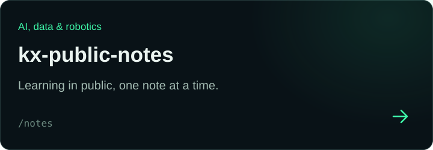
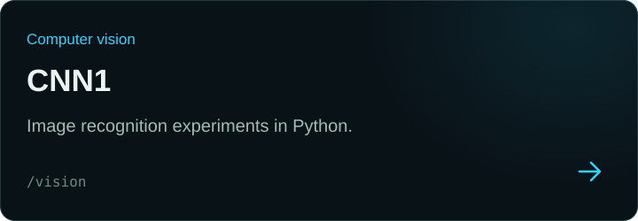
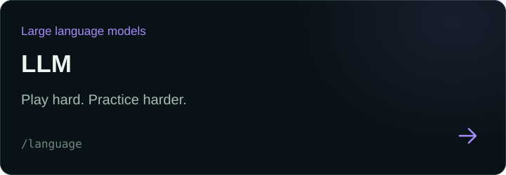
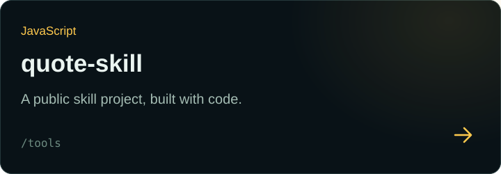

<div align="center">

<a href="https://asdasas1212.github.io/asdasas1212/">

</a>

**让机器人看懂世界，再走向世界。**

Robotics · Vision-Language Models · Visual Navigation

感知 → 理解 → 规划 → 行动，打开主页即可观看上方的循环演示。

<sub>预设场景示意 · 每 18 秒循环</sub>

[浏览公开项目](https://github.com/asdasas1212?tab=repositories&type=source) &nbsp; / &nbsp; [阅读公开笔记](https://github.com/asdasas1212/kx-public-notes)

</div>

<br>

## 从感知到行动

我是 **hkx**，也可以叫我 **asdasas1212**。关注机器人视觉、视觉语言模型与室内导航，希望把自然语言里的目标，变成机器人可以执行的行动。

```text
$ cat focus.txt
  learning   ROS2 + vision-language models
  building   视觉室内导航 demo
  exploring  perception → grounding → planning → action
```

> 想做的事：让机器人听懂「去厨房拿个杯子」，也理解这句话背后的空间和目标。

## 公开项目

<table>
  <tr>
    <td width="50%"><a href="https://github.com/asdasas1212/kx-public-notes"></a></td>
    <td width="50%"><a href="https://github.com/asdasas1212/CNN1"></a></td>
  </tr>
  <tr>
    <td width="50%"><a href="https://github.com/asdasas1212/LLM"></a></td>
    <td width="50%"><a href="https://github.com/asdasas1212/quote-skill"></a></td>
  </tr>
</table>

## 正在使用和学习的工具

| 感知 Perception | 理解与决策 Reasoning | 系统与执行 Systems |
| --- | --- | --- |
| OpenCV · PyTorch · YOLO | VLM · Nav2 · SLAM | ROS2 Humble · Linux |
| PCL · CUDA | Python · C++ | Docker · CMake · Git · Shell |

## 学习路径

从图像识别，到语言与视觉，再到机器人的空间理解和行动闭环。这里也保留了我关注的开源项目：

- [minimind](https://github.com/asdasas1212/minimind) — fork 自 [jingyaogong/minimind](https://github.com/jingyaogong/minimind)，学习小参数语言模型。
- [unsloth](https://github.com/asdasas1212/unsloth) — fork 自 [unslothai/unsloth](https://github.com/unslothai/unsloth)，探索模型微调工具。
- [code-animation-prompts](https://github.com/asdasas1212/code-animation-prompts) — fork 自 [XiaoyeCodes/code-animation-prompts](https://github.com/XiaoyeCodes/code-animation-prompts)，探索代码动画与可视化表达。

<br>

<div align="center">

**See the world. Understand the world. Move through it.**

[手动切换步骤与体验鼠标互动](https://asdasas1212.github.io/asdasas1212/) · [GitHub](https://github.com/asdasas1212)

</div>

<!-- Maintenance: assets/generate_profile.py rebuilds local artwork with Pillow + NumPy.
     profile-showcase.svg is a hand-authored, self-contained animated SVG.
     The animated SVG showcase is self-hosted and includes a reduced-motion layout.
     index.html is the standalone GitHub Pages site.
     The Pages demo is an illustrative replay, not real-time model inference. -->
